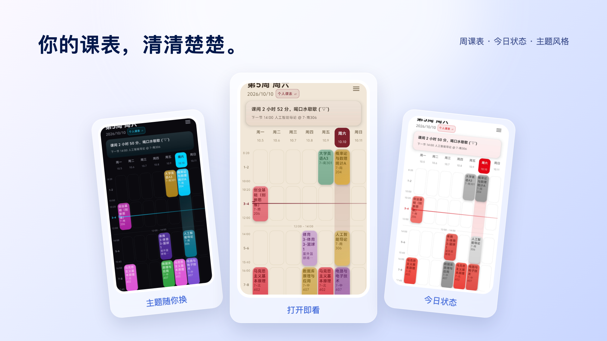
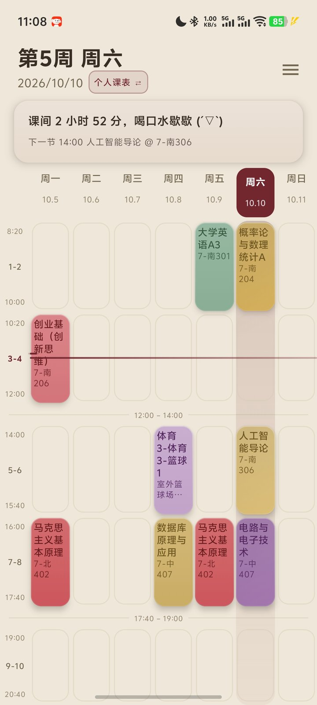
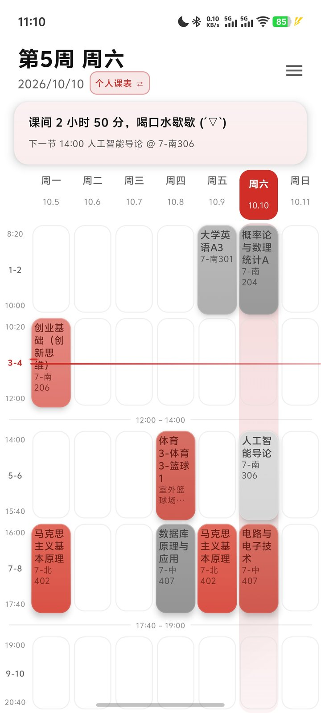
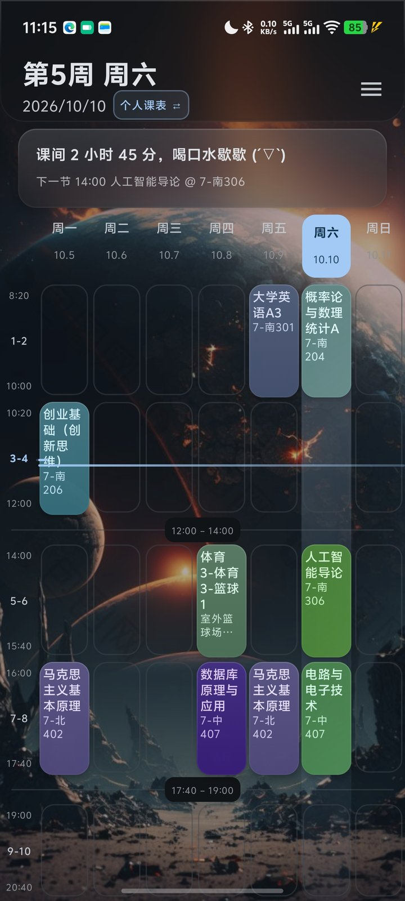
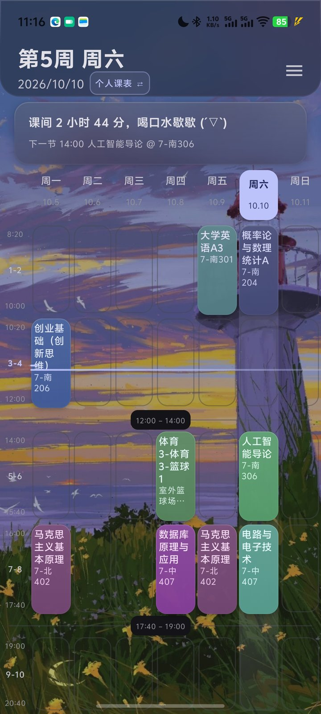

<div align="center">


# 长工课表通

**`你的课表，清清楚楚！早八，心中有数！`**

<!-- 发版时记得更新此行 -->
`最后更新时间：2026.10.15`

[](https://github.com/yi-san-spce/ccsut-kb/releases/latest) [](LICENSE)   [](https://github.com/yi-san-spce/ccsut-kb/actions/workflows/ci.yml)

**[GitHub](https://github.com/yi-san-spce/ccsut-kb) • [QQ 频道](https://pd.qq.com/s/9pnez0un5?b=9) • [QQ 交流群](#-加入社区)**



😊 这是一款为**长沙工业学院（CCSUT）学生**打造的**课表查看 / 编辑 / 提醒工具**：`班级课表 + 个人课表 + 课前提醒 + 桌面小组件` 一应俱全，**具有开箱即用、离线可用的特点**——原生 Kotlin + Jetpack Compose，零第三方网络库，APK 体积小、启动快，一次配置四年受用！

> **🚀 点击右上角 ☰ 打开目录，选择您要阅读的部分**

<big>_**应用为非官方校园工具**：课表数据来自学校教务系统公开接口；个人课表登录凭证**仅存内存**、验证码即弃，隐私细节见 [PRIVACY.md](docs/PRIVACY.md)_</big>

</div>

**目录**：[💡 功能](#-功能说明) · [📲 下载](#-下载给用户) · [💬 加入社区](#-加入社区) · [🛠 开发者指南](#%EF%B8%8F-开发者指南) · [🤝 参与贡献](#-参与贡献) · [⭐ 贡献者](#-贡献者-) · [📄 开源协议](#-开源协议)

---

## 💡 功能说明

* **部署快速、使用方便的课表查看 + 编辑 + 提醒一体化工具**
  >

  ```
  📱 打开「长工课表通」，一切井井有条
  ├── 📅 班级课表 —— 228 个班数据集内置，选班即用，无网可看
  │   ├── 周次切换 · 今日状态 · 课程详情（时间/教师/教室/周次/合班）
  │   └── 本地编辑：点空格加课 · 改节数/时间 · 改色 · 隐藏 · 一键还原
  ├── 🎓 个人课表（可选）—— 短信验证码登录教务，选课/重修一个不落
  ├── ⏰ 课前提醒 + 放学小结 + 早八前夜 —— 定时通知，分级通道不扰课
  ├── 🧩 桌面小组件 —— 今日课表贴桌面，Material You 动态取色
  ├── 🎨 5 套主题风格 × 浅色/暗色 —— 学院风 · 瑞士极简 · 太空 · 灯塔 · 卡带未来
  └── 🔄 应用内更新 —— APK 与课表数据双通道，数据热更无需重装
  ```

* **一次选班，四年受用**：内置全院班级课表数据集，选完即用，无网也能看
* **数据热更，无需重装**：学校换课？课表数据包走 GitHub 通道（镜像加速）独立热更，实时跟进
* **本地编辑，改了就归你**：编辑记录只存本机（`user_edits.json` 覆盖层），永不改动学校数据
* **早八救星**：课前提醒提前 5/10/15/20/30 分钟可选，通知分级通道不扰课，上课后不补响
* **颜值即正义**：Material You 动态取色 / 液态玻璃 / 背景图取色，5 套主题风格 × 浅色暗色随心换

<div align="center">

| 学院风 · 浅色 | 瑞士极简 · 浅色 | 太空 · 背景取色 | 灯塔插画 · 背景取色 |
|:---:|:---:|:---:|:---:|
|  |  |  |  |

</div>

---

## 📲 下载（给用户）

| 渠道 | 适合 | 入口 |
|---|---|---|
| **应用内更新**（推荐） | 已安装用户 | 「更多 → 软件更新」看版本历史与说明，支持升级与回退；镜像加速（自动测速选最快）默认开启，可切官方直连；课表数据集独立热更，无需重装 |
| **GitHub Releases** | 所有用户 | [下载最新版 APK](https://github.com/yi-san-spce/ccsut-kb/releases/latest)（附各版本说明与历史版本；应用内更新已内置镜像加速，国内无需科学上网） |

> 系统要求 Android 12+。vivo/OPPO 等厂商手机建议在系统设置中允许自启动并加入省电白名单。

---

## 💬 加入社区

反馈与交流的首选是 QQ——**加群直接说话，维护者在线**：

<div align="center">

| 💬 QQ 交流群 | 📺 QQ 频道 |
|:---:|:---:|
| **长工课程通社区**<br/>群号 `1129626080`<br/>QQ 搜索加群，或应用内「关于 → 加入社区」一键直达 | [**长沙工业学院校园论坛**](https://pd.qq.com/s/9pnez0un5?b=9)<br/>公告 · 讨论 · 抢先体验<br/>扫码进入：  |
| [](#-加入社区) | [](https://pd.qq.com/s/9pnez0un5?b=9) |

**觉得有用？给 [GitHub](https://github.com/yi-san-spce/ccsut-kb) 一个 Star —— 这是开源作者持续更新的全部动力。**

</div>

发现具体问题也可以走 **[Issue 分类模板](https://github.com/yi-san-spce/ccsut-kb/issues/new/choose)**（🐛 问题反馈 / 💡 功能建议，课表数据问题在问题反馈里选类型），点对应入口即可，不用自己纠结怎么写。

---

## 🛠 开发者指南

原生 **Kotlin + Jetpack Compose**，零第三方网络库（登录链路为纯 `HttpURLConnection` 实现），离线优先。

**快速开始（15 分钟上手）**：

```bash
git clone https://github.com/yi-san-spce/ccsut-kb.git
cd ccsut-kb/android
./gradlew assembleDebug        # 仓库自带 Gradle Wrapper，无需装 Gradle
./gradlew installDebug         # 装到连接的设备/模拟器
```

或直接用 **Android Studio 打开 `android/` 目录**，点 ▶ 运行。

**文档矩阵——按你想做的事找文档**：

| 我想… | 文档 |
|---|---|
| 把项目跑起来、配环境、过一遍开发工作流 | [docs/上手教程/getting-started.md](docs/上手教程/getting-started.md) |
| 理解代码架构与数据流，准备动手改 | [docs/原理与接口/architecture.md](docs/原理与接口/architecture.md) |
| 查某个功能的入口与实现细节 | [docs/上手教程/features.md](docs/上手教程/features.md) |
| 数据链路与登录链路的技术细节 | 接口调用细节不在文档中展开 |
| 查术语 / 行话定义（覆盖层、双链、CAS…） | [docs/glossary.md](docs/glossary.md) |
| 发布新版本 / 更新课表数据 | [docs/开发者/release.md](docs/开发者/release.md) |
| 看每个版本改了什么 | [docs/CHANGELOG.md](docs/CHANGELOG.md) · [docs/release-notes/](docs/release-notes/) |

发布签名：自建 `keystore/release.keystore`，口令写入 `android/local.properties` 的 `keystore.password=<你的口令>`（该文件已被 gitignore，**不要**把口令提交进仓库）。

### 数据来源与质量保障

- **班级课表数据集**：`scripts/scrape.py` 从学校教务系统公开接口整理（228 个班），打包进应用并可通过更新通道热更新；`scripts/publish.sh` 一条龙发布
- **单元测试**：解析、周次计算、合并、编辑覆盖层等纯函数 99 个用例（`android/app/src/test/`）
- **CI**：每次推送自动跑版本双写校验 + 测试 + 构建冒烟；**发布门禁** `scripts/publish.sh` 拒绝在脏工作区发版，APK 版本号从产物本身读取
- 数据获取与登录链路遵循「只读、仅本人数据、无中间服务器」原则（见 [PRIVACY.md](docs/PRIVACY.md)）；技术细节文档不在文档中展开，欢迎通过 Issue 交流

---

## 🤝 参与贡献

欢迎任何形式的参与：报告问题、补充数据、写代码、改文档。提交 PR 前请确认 `./gradlew checkVersionSync testDebugUnitTest` 通过；提交信息遵循 [Conventional Commits](docs/开发者/CONTRIBUTING.md#提交规范conventional-commits)。详见 **[贡献指南](docs/开发者/CONTRIBUTING.md)**。

社区行为遵循 [行为准则](docs/开发者/CODE_OF_CONDUCT.md)；安全漏洞请按 [安全政策](docs/开发者/SECURITY.md) **私下**报告，勿公开提交。

## ⭐ 贡献者 ✨

**感谢每一位让「长工课表通」变好的朋友！！！**

> 如果您也想要为这个项目添砖加瓦，可以直接去 [Issues](https://github.com/yi-san-spce/ccsut-kb/issues) 提出您宝贵的建议，或者直接提交 PR——你的头像将出现在这里！

<a href="https://github.com/yi-san-spce">

</a>
<a href="https://github.com/wudhlgers">

</a>

## 📈 Star History

<a href="https://star-history.com/#yi-san-spce/ccsut-kb&Date">
  <picture>
    <source media="(prefers-color-scheme: dark)" srcset="https://api.star-history.com/svg?repos=yi-san-spce/ccsut-kb&type=Date&theme=dark" />
    <source media="(prefers-color-scheme: light)" srcset="https://api.star-history.com/svg?repos=yi-san-spce/ccsut-kb&type=Date" />
    
  </picture>
</a>

---

## 📄 开源协议

长工课表通原创代码采用 [GPL-3.0](LICENSE) 协议，允许使用、修改、移植、再发布及商业使用；分发时须保留版权声明和协议全文。与宽松协议不同，**修改后的衍生版本必须以同协议（GPL-3.0）开源**——分发应用（含 APK）时须向接收者提供对应源码或源码获取途径（指向本仓库 GitHub 地址即可）。软件按现状提供，不作任何担保。

欢迎社区制作移植版本与二次开发版本。请在衍生版本的说明中注明原项目与修改内容，清楚区分社区版本和官方版本；GPL-3.0 不授予「长工课表通」品牌名称或 Logo 的商标使用权。

课表数据集（`data/` 及应用内置数据）来自学校教务系统公开接口，版权归学校及原权利人所有，适用其各自授权，仅供学习交流与个人校园使用，不因本仓库的 GPL-3.0 协议获得额外授权。
